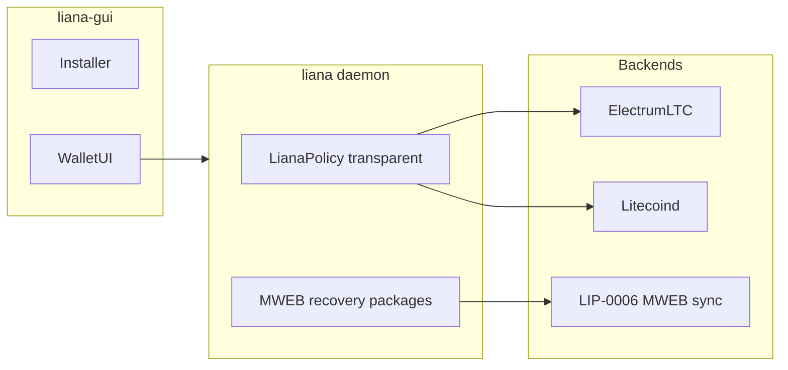

# Liana Litecoin — plan, goals, and todos

Living document for [LitecoinDevKit/liana-ltc](https://github.com/LitecoinDevKit/liana-ltc).
Update this file as phases complete. Scaffold only as of Phase 0 — no Litecoin code yet.

## Goals

- Desktop Litecoin wallet for **inheritance**, **loss protection**, and **safer backups**
- **Transparent vault** with Liana-parity Script / miniscript recovery (`older(N)`, multipath, multisig)
- **Private Litecoin (MWEB)** with the **same recovery *features*** via wallet protocol (height-locked
  pre-signed spends after non-interactive receive) — not Script CSV on MWEB outputs
- **Nexus-compatible** MWEB keys (Litecoin Core scheme) for mobile interop without embedding Nexus
- Depend on **LitecoinDevKit** (MIT/Apache) for chain + MWEB — never GPL Nexus / `lndltc` / in-process `mwebd`
- Stay a thin, mergeable fork of [wizardsardine/liana](https://github.com/wizardsardine/liana) where practical

## Non-goals (v1)

- Lightning or other L2s
- Embedding Nexus, `lndltc`, or gomobile `mwebd`
- Claiming Script timelocks or “identical security model to Liana” for MWEB
- Shipping unsigned / unaudited mainnet releases
- Liana Connect / SaaS backend parity on day one
- Renaming Rust crates away from `liana*` until a deliberate branding decision

## Architecture (target)

Two ledgers under one UI. Transparent policy stays Liana’s descriptor engine; MWEB state stays
parallel (LDK `MwebStore` / coin DB — never fold HogAddr into the transparent UTXO index).

| Account | Mechanism | Recovery enforcement |
|---------|-----------|----------------------|
| **Vault (transparent)** | Liana multipath miniscript descriptors | On-chain Script relative timelock (`older(N)`) |
| **Private (MWEB)** | LDK MWEB + LIP-0006 scan | Post-scan pre-signed txs with kernel `lock_height`; backup for heirs |

Marketing-safe summary: same *features* on both accounts; transparent = network Script; MWEB = wallet
height-lock packages.

## Phased todos

### Phase 0 — Repo scaffold (this pass)

- [x] Fork `wizardsardine/liana` → `LitecoinDevKit/liana-ltc`
- [x] Rewrite root `README.md` for Liana Litecoin
- [x] Add this `docs/PLAN.md`
- [x] Add `UPSTREAM.md` (fork SHA + merge notes)
- [ ] Create `litecoin` working branch when Phase 1 starts

### Phase 1 — Litecoin transparent port

- [ ] Alias / swap chain types (`bitcoin` → `litecoin` / rust-litecoin) across daemon + GUI
- [ ] Networks, address formats (`ltc1…`), fee defaults, dust
- [ ] Backends: Electrum-LTC and/or `litecoind` RPC (prefer Electrum-first for light clients)
- [ ] Keep Liana policy / descriptor compiler; validate on Litecoin Script
- [ ] CI: build + unit tests on Litecoin types

### Phase 2 — Dogfood transparent vault

- [ ] Testnet: create vault → receive → primary spend → wait/CSV → recovery spend
- [ ] Installer copy for Litecoin networks
- [ ] Document regtest / testnet recipes

### Phase 3 — Wire LDK MWEB (spend/sync, no recovery yet)

- [ ] Pin blessed LDK ladder from [`bdk` ADOPTION.md](https://github.com/LitecoinDevKit/bdk/blob/litecoin/docs/ADOPTION.md)
- [ ] Parallel MWEB coin DB + LIP-0006 sync
- [ ] Combined balance; peg-in / MWEB send / peg-out (maps-first API)
- [ ] Broadcast / wtxid caveats for pure MWEB
- [ ] Do **not** index HogAddr as transparent UTXOs

### Phase 4 — MWEB recovery packages

- [ ] On each MWEB receive: auto-build recovery tx(s) with `lock_height = coin_height + N`
- [ ] Multiple staged paths / multisig via MuSig where needed
- [ ] Encrypted export / heir backup format; refresh recoveries after self-spends
- [ ] UI: “recovery available in X blocks/days” with honest enforcement copy

### Phase 5 — Bridge + product polish

- [ ] One-click peg-out to transparent vault address
- [ ] Installer: heir flows for vault vs MWEB (Script vs pre-sign backup)
- [ ] Optional reminders to peg out / refresh recoveries

### Phase 6 — Hardening and release

- [ ] Security review; threat model for MWEB recovery backups
- [ ] HWI for transparent vault (soft-key first)
- [ ] Signed releases; mainnet disclaimer until ready

## Dependencies / pins

When Phase 3 starts, follow the **blessed consumer pin** table in
[LitecoinDevKit/bdk `docs/ADOPTION.md`](https://github.com/LitecoinDevKit/bdk/blob/litecoin/docs/ADOPTION.md)
(`bdk` / `bdk_wallet` / `bdk-ffi` rev ladder). Do not invent divergent PSBT MWEB maps.

Upstream Liana currently uses its own electrum / coin-select stack; Phase 1 may keep that shape and
introduce LDK primarily for MWEB in Phase 3, unless transparent port economics favor earlier BDK.

## Open questions

- Final product branding beyond “Liana Litecoin” (BSD non-endorsement; trademark caution)
- Whether to offer a Liana Connect–like hosted backend for LTC
- Heir backup UX: file vs QR vs third-party solicitor flow
- Relative vs absolute delay UX copy for MWEB `lock_height`
- How aggressively to track `upstream/master` vs diverge for LDK integration

## References

- Onboarding: [`ONBOARDING.md`](ONBOARDING.md)
- Upstream: [wizardsardine/liana](https://github.com/wizardsardine/liana)
- LDK: [LitecoinDevKit/bdk](https://github.com/LitecoinDevKit/bdk) (esp. `ADOPTION.md`, `MWEB_ARCHITECTURE.md`)
- Fork hygiene: [`UPSTREAM.md`](../UPSTREAM.md)
