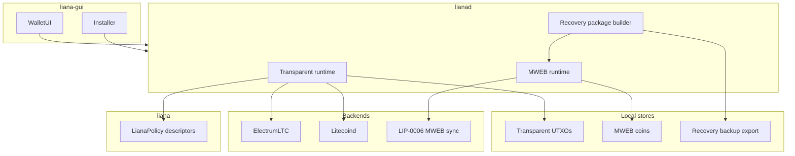

# Liana Litecoin — plan, goals, and todos

Living document for [LitecoinDevKit/liana-ltc](https://github.com/LitecoinDevKit/liana-ltc).
Update this file as phases complete. Scaffold only as of Phase 0 — no Litecoin code yet.

## Goals

- Desktop Litecoin wallet for **inheritance**, **loss protection**, and **safer backups**
- **Transparent vault** with Liana-parity Script / miniscript recovery (`older(N)`, multipath, multisig)
- **Private Litecoin (MWEB)** with the **same recovery *features*** via wallet protocol (height-locked
  pre-signed spends after non-interactive receive) — not Script CSV on MWEB outputs
- **Nexus-compatible** MWEB keys (Litecoin Core scheme) for mobile interop without embedding Nexus
- Depend on **LitecoinDevKit** (MIT/Apache) for chain + MWEB — never GPL Nexus / `lndltc` / in-process `mwebd`
- Stay a thin, mergeable fork of [wizardsardine/liana](https://github.com/wizardsardine/liana) where practical

## Non-goals (v1)

- Lightning or other L2s
- Embedding Nexus, `lndltc`, or gomobile `mwebd`
- Claiming Script timelocks or “identical security model to Liana” for MWEB
- Shipping unsigned / unaudited mainnet releases
- Liana Connect / SaaS backend parity on day one
- Renaming Rust crates away from `liana*` until a deliberate branding decision

## Architecture (target)

Two ledgers under one UI. Transparent stays Liana-shaped (thin fork); MWEB is **additive** modules in
the daemon — not a rewrite of the descriptor engine. Feature parity for recovery UX; **not**
mechanism parity (see Non-goals).

### Components

| Layer | Role |
|-------|------|
| `liana` | Transparent policy / multipath descriptors / spend & Script recovery planning |
| `lianad` transparent runtime | Coin index, Electrum-LTC and/or litecoind, JSON-RPC — Liana shape |
| `lianad` MWEB runtime | LDK `MwebStore` / coin DB, LIP-0006 sync, peg-in/out, MWEB spend/broadcast |
| Recovery packages | Build / refresh / encrypt / export pre-signed MWEB recovery txs (Phase 4) |
| `liana-gui` | Installer + wallet UI; vault vs Private accounts; honest recovery copy |

### Data plane (three stores — never merge)

1. **Transparent UTXOs** — descriptor wallet coins (Script / CSV clock via chain tip).
2. **MWEB coins** — parallel LDK store; never index HogAddr as transparent UTXOs.
3. **Recovery package backup** — heir-held artifact (encrypted export); must be refreshed after
   self-spends. Chain does not store this for the heir.

### Account model

One desktop wallet, **two accounts** under one UI (combined balance is a view, not a merged UTXO set):

- **Vault** — transparent Liana multipath descriptor.
- **Private** — MWEB keys (Nexus-compatible scheme) + LDK sync.

Peg-in / peg-out are bridge flows between accounts (Phase 3 spend/sync; Phase 5 one-click peg-out to
vault). Connect / SaaS is out of v1.

### Trust / enforcement

| Account | Mechanism | Recovery enforcement | Clock |
|---------|-----------|----------------------|-------|
| **Vault** | Liana multipath miniscript | Network Script `older(N)` | Relative (CSV / coin age) |
| **Private** | LDK MWEB + LIP-0006 | Pre-signed txs with kernel `lock_height` + heir backup | Absolute (block height) |

- Vault: chain refuses early recovery spends; heir needs keys after delay.
- Private: chain enforces `lock_height` on the prepared kernel; heir also needs a **correct, current
  backup**. Wrong or stale packages are a wallet-protocol failure, not a Script failure.

Marketing-safe summary: same *features* on both accounts; transparent = network Script; MWEB = wallet
height-lock packages.

## Phased todos

### Phase 0 — Repo scaffold (this pass)

- [x] Fork `wizardsardine/liana` → `LitecoinDevKit/liana-ltc`
- [x] Rewrite root `README.md` for Liana Litecoin
- [x] Add this `docs/PLAN.md`
- [x] Add `UPSTREAM.md` (fork SHA + merge notes)
- [ ] Create `litecoin` working branch when Phase 1 starts

### Phase 1 — Litecoin transparent port

Keep the port **thin** (aliasing over rewrite); verify with builds/tests — see
[`doc/AI_NATIVE_FORKING.md`](../doc/AI_NATIVE_FORKING.md).

- [ ] Alias / swap chain types (`bitcoin` → `litecoin` / rust-litecoin) across daemon + GUI
- [ ] Networks, address formats (`ltc1…`), fee defaults, dust
- [ ] Backends: Electrum-LTC and/or `litecoind` RPC (prefer Electrum-first for light clients)
- [ ] Keep Liana policy / descriptor compiler; validate on Litecoin Script
- [ ] CI: build + unit tests on Litecoin types

### Phase 2 — Dogfood transparent vault

- [ ] Testnet: create vault → receive → primary spend → wait/CSV → recovery spend
- [ ] Installer copy for Litecoin networks
- [ ] Document regtest / testnet recipes

### Phase 3 — Wire LDK MWEB (spend/sync, no recovery yet)

Lean on LDK; verify hard paths with library / golden / reference vectors where possible
(oracle ≠ embedding `mwebd`).

- [ ] Pin blessed LDK ladder from [`bdk` ADOPTION.md](https://github.com/LitecoinDevKit/bdk/blob/litecoin/docs/ADOPTION.md)
- [ ] Parallel MWEB coin DB + LIP-0006 sync
- [ ] Combined balance; peg-in / MWEB send / peg-out (maps-first API)
- [ ] Broadcast / wtxid caveats for pure MWEB
- [ ] Do **not** index HogAddr as transparent UTXOs

### Phase 4 — MWEB recovery packages

- [ ] On each MWEB receive: auto-build recovery tx(s) with `lock_height = coin_height + N`
- [ ] Multiple staged paths / multisig via MuSig where needed
- [ ] Encrypted export / heir backup format; refresh recoveries after self-spends
- [ ] UI: “recovery available in X blocks/days” with honest enforcement copy

### Phase 5 — Bridge + product polish

- [ ] One-click peg-out to transparent vault address
- [ ] Installer: heir flows for vault vs MWEB (Script vs pre-sign backup)
- [ ] Optional reminders to peg out / refresh recoveries

### Phase 6 — Hardening and release

- [ ] Security review; threat model for MWEB recovery backups
- [ ] HWI for transparent vault (soft-key first)
- [ ] Signed releases; mainnet disclaimer until ready

## Dependencies / pins

When Phase 3 starts, follow the **blessed consumer pin** table in
[LitecoinDevKit/bdk `docs/ADOPTION.md`](https://github.com/LitecoinDevKit/bdk/blob/litecoin/docs/ADOPTION.md)
(`bdk` / `bdk_wallet` / `bdk-ffi` rev ladder). Do not invent divergent PSBT MWEB maps.

Upstream Liana currently uses its own electrum / coin-select stack; Phase 1 may keep that shape and
introduce LDK primarily for MWEB in Phase 3, unless transparent port economics favor earlier BDK.

## Open questions

- Final product branding beyond “Liana Litecoin” (BSD non-endorsement; trademark caution)
- Whether to offer a Liana Connect–like hosted backend for LTC
- Heir backup UX: file vs QR vs third-party solicitor flow
- Relative vs absolute delay UX copy for MWEB `lock_height`
- How aggressively to track `upstream/master` vs diverge for LDK integration

## References

- Onboarding: [`ONBOARDING.md`](ONBOARDING.md)
- AI-native forking: [`doc/AI_NATIVE_FORKING.md`](../doc/AI_NATIVE_FORKING.md)
- Upstream: [wizardsardine/liana](https://github.com/wizardsardine/liana)
- LDK: [LitecoinDevKit/bdk](https://github.com/LitecoinDevKit/bdk) (esp. `ADOPTION.md`, `MWEB_ARCHITECTURE.md`)
- Fork hygiene: [`UPSTREAM.md`](../UPSTREAM.md)
